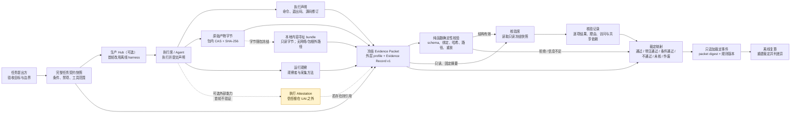

# UAI 证据约束裁定：架构设计

- 版本：设计草案 v0.2（DSH 只读评阅后修订）
- 日期：2026-11-24
- 状态：待天枢最终独立核验；设计不代表实现保证

## 1. 设计目标

在代码交付验收场景中，把任务约束、执行方声明、原始产物、运行观察、核验过程和裁定绑定到一个自包含、可离线复算的证据包。首轮只验证协议机制和确定性校验，不声称已经证明语义验收可靠、执行真实或市场愿意付费。

设计复用 UAI 的 Evidence Record v1、任务契约、结果指针和裁定词表。外层 packet 是一个试验 profile，不另造第二份证据记录格式。

## 2. 冻结证据包结构

Evidence Packet v0.1 至少包含：

1. **contract_snapshot**：任务 ID、契约 ID/版本/规范摘要、完整验收条件、禁止项、工具范围和预期产物。契约快照完整随包保存，离线复算不依赖外部读取。
2. **evidence_records[]**：每一项严格引用 `../../protocol/unified/evidence-record.schema.json` 并通过该 schema 校验。相对路径以 packet schema 文件 URI 为基准；空 schema registry、禁网络解析。该 v1 schema 仍是证据记录的唯一规范；packet schema 只描述外层结构及跨字段约束。task_id 在 packet、contract_snapshot 和每条 v1 record 中一致；run_id/contract_id 由 packet/claim/verifier 层承载，因为 v1 不含这些字段。每条 v1 record 的 `payload.uri` 必须与 manifest 的 bundle-relative path 完全相等，sha256/bytes 与 manifest 及真实包内字节一致；revision 按 v1 现有字段与 claim 比较，缺失视为 unknown，不扩展 v1。
3. **execution_claim**：实现者 principal、运行/尝试 ID、源码修订、声明的命令/工具/模型版本、起止时间和声明的退出码。该对象只记录声明。
4. **runtime_observation**：观察者、采集方法、观察到的运行状态和时间。观察来源与执行者声明分开；未被可信签名保护的观察也不是强真实性证明。
5. **artifact_manifest**：产物 ID、包内规范相对路径、字节数、SHA-256、媒体类型、来源修订与采集时间；全部产物字节随离线 bundle 冻结。路径限定为 Unicode NFC 的 POSIX 相对路径，拒绝反斜杠、盘符、UNC、空段、`.`/`..`、URI scheme、大小写/规范化碰撞、重复路径及非普通文件；loader 拒绝 symlink、junction 和硬链接，并验证 resolved path 在 bundle 根内。
6. **verifier_record**：核验者 principal/issuer/认证状态、读取的 packet 摘要、访问历史、核验方法版本、运行环境、共享模型/提示/工具依赖、逐项结果和理由。
7. **adjudication**：packet 摘要、规则版本、逐项证据引用、最终裁定词和时间。
8. **event_reference**：追加式事件 ID、前序摘要和 packet 摘要，用来检测记录变动，不用于证明事件来源真实。

`bundle.as_of` 和 `contract_snapshot.evidence_max_age_seconds` 固定有效期判定；`asserted_at` 必须是 RFC3339 UTC，超期映射为“证据不足/未核”。首轮使用实验专属 `UAI-CJSON-v1`：UTF-8、对象键按 Unicode code point 排序、无空白分隔符、非 ASCII 原样输出、拒绝重复键/浮点数、字符串须 NFC；此规则刻意限定输入，不声称实现 RFC 8785。manifest 按 path 排序。packet digest 的精确覆盖集合为 `contract_snapshot, evidence_records, artifact_manifest, execution_claim, runtime_observation, reviewer_record, adjudication_input, rules_version`；产物字节由 manifest 中 SHA-256 和字节数绑定。`verifier_record` 与最终 event 不参与自身摘要，后续追加事件用 `prev_digest` 链接。规范化器版本/hash放入冻结 manifest。复算单元是 bundle 加固定规则仓库 commit；bundle 本身不包含全部规则源文件。URI 不用于网络取回本轮数据，禁止执行路径。

## 3. 证据与身份的证明上限

- **哈希和 manifest**：证明当前读到的字节与所声明摘要相符；若存储管理员能同时改字节和摘要，则不能证明历史真实性或抵御恶意管理员。
- **执行者声明**：说明执行者声称了什么，不证明命令实际运行。
- **运行观察**：只有采集器和存储链被信任时才提升证明力；首轮仅把它当结构化观察。
- **execution_attestation**：首轮明确 out of scope；不实现信任根、签名验证器或可信等级升级。缺少外部可信 attestation 时，报告不得声称命令真实执行已经得到证明。
- **身份**：记录 issuer、subject、认证器、有效期和撤销状态。未验证的身份标为 asserted；不同 ID 只说明标识符不同。
- **核验独立性**：分别记录身份分离、职责分离、盲审/信息隔离、只读快照、环境/凭据隔离、共享模型/提示/工具、组织关系和配对错误统计。没有独立性总分或简单布尔值；样本不足时写“无法估计”。

## 4. 裁定流程

1. 生产 Hub 或离线 harness 固定完整任务契约和逐项验收条件；首轮只使用离线 harness，不连接生产 Hub。
2. 执行席提交声明和产物；封装器将包所需的所有字节复制进内容寻址 bundle 并生成 manifest。
3. 纯函数校验器验证 JSON Schema、v1 evidence records、字段绑定、摘要、包内路径和契约要求；不执行 shell、不连网络、不写生产 Hub。
4. 核验席对冻结包只读访问；记录它实际读取的 packet 摘要、访问路径、方法版本和共享依赖。
5. 每项验收条件产生 pass / fail / unknown 和证据引用。合成 oracle 只在独立指标阶段载入，verifier 只接收 packet，不能读 oracle。逐例仅当输出 verdict 属于 oracle 的 allowed set 才算正确：有效样本 `{通过}`，已声明不通过样本 `{不通过}`（只检验裁定标记一致性，不测真实语义缺陷识别），证据不足 `{未核, 不通过}`。有效包的未核/作废计误拒；只有 oracle 标注作废的样本排除分母，verifier 输出作废计错。
6. 最终裁定遵循 UAI 现有中文词表：通过、带注通过、条件通过、不通过、未核、作废。
7. 追加裁定事件；任何变更生成新 packet version，不覆盖旧证据。
8. 离线复算器使用包内字节、既有 v1 schema 和固定规则版本重建裁定并报告差异。

试点不复用 stage2/three_layer_verdict.py 的 execute_all 或 shell 检查实现；只复用裁定词汇。未核、作废不能变成 pass；零样本/单样本不能被报告为 100% 一致。

## 5. 裁定映射

- 有效且所有必需条件满足：允许“通过”。
- 有已知、明确且不阻断的条件并写明责任人和期限：才允许“带注通过”或“条件通过”。
- 有证据支持实质缺陷：允许“不通过”。
- 证据不足、矛盾、身份要求未满足或运行来源无法确认：允许“未核”；不得计为通过或把它自动算成实质失败。
- oracle 标记样本或任务不适用时可以“作废”，必须记录原因；只有 oracle 标签预先标记的作废样本可排除错误率分母。verifier 输出“作废”始终计错，且有效 fixture 上的“未核/作废”均计误拒。

合成 fixture 的 oracle 逐例声明可接受裁定集合。它是测试规则，不是专家对真实代码质量的权威结论。

## 6. 信任边界与威胁处理

| 威胁 | 处理 | 剩余边界 |
|---|---|---|
| 证据挂错任务/修订 | 强制 task/run/contract/revision 交叉绑定 | revision 来源仍可能是声明 |
| 产物偶然损坏 | 包内摘要与字节数检查 | 可发现不匹配，不证明最初内容真实 |
| 执行者编造命令结果 | claim 与 observation 分开，无 attestation 降级 | 当前 UAI 不能证明命令实际执行 |
| 路径越界或网络取数 | loader 只接受 NFC POSIX 相对路径并拒绝 UNC、绝对路径、URL、symlink/junction/hardlink | 路径语法与文件系统检查分层；Windows 实测需覆盖 junction/hardlink 边界 |
| 核验者看过执行者结论 | 访问事件和盲审字段 | 若日志由同一主体控制，仍属自报 |
| 核验者共同误判 | 后续配对盲测，报告共享依赖及共同漏检 | 不同厂商也可能相关；首轮没有估计 |
| 本地管理员改包与日志 | 记录 hash chain、规则与运行版本 | 同一管理员可改字节与摘要；没有外部锚点就不具抗恶意篡改性 |

## 7. 架构图

独立 Mermaid 源为 docs/architecture/diagrams/evidence-bound-adjudication.mmd。下图与该源文件保持一致；execution attestation 是外部可选输入，不是 UAI 已实现的能力。

## 8. 首轮实现约束

首轮为离线 Python 原型：只读冻结 bundle，输出可复算 JSON；不接生产 Hub、不访问外网、不加载席位凭据、不执行契约内 shell 命令。外层 schema 复用 Evidence Record v1；新增 profile 必须用兼容测试锁定映射。

可复用外部组件：JSON Schema validator、对象存储/CAS、CI runner attestation、OIDC 或签名库。必须由 UAI 自己掌握：证据记录 profile、task/evidence/artifact 绑定规则、证据充分性边界、裁定词与映射、核验者隔离记录和错误率评测。

## 9. 后续研究问题（不阻塞首轮离线原型）

1. 哪个 CI/执行环境能提供可信 execution attestation，信任根由谁管理？
2. 生产环境如何把不可篡改锚点与 UAI Hub 的管理员权限分离？
3. 下一阶段真实 reviewer 比较需要多少样本，如何随机分配和估计共同漏检率？
