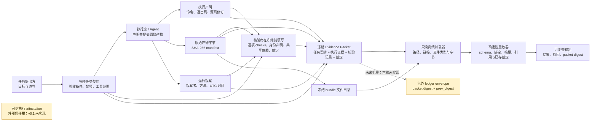

# UAI 证据约束裁定：架构设计

- 版本：设计草案 v0.2（DSH 只读评阅后修订）
- 日期：2026-11-24
- 状态：本机复现完成；DSH 第三轮文档复阅 PASS（无阻断）；天枢独立核验受审批沙箱阻挡，pending/no-go

## 0. 术语

- **packet**：单个 `packet.json`，承载契约、证据记录、执行声明、观察、manifest、核验记录、最终裁定与冻结版本字段。
- **bundle directory**：文件目录，包含 `packet.json` 与 manifest 指向的产物字节；packet 内 `bundle` 对象只保存 `as_of` 和 manifest 路径索引，不代表所有字段都嵌套在该对象内。
- **ledger envelope**：未来可在 packet 外引用 packet digest 与 `prev_digest` 的事件记录；本轮未实现，也没有跨包 hash chain。

## 1. 设计目标

在代码交付验收场景中，把任务约束、执行方声明、原始产物、运行观察、核验过程和裁定绑定到一个可离线复算的证据包。复算单元为固定仓库版本下的规则文件、schema 与 bundle，不声称 bundle 单独包含所有规则源。首轮只验证协议机制和确定性校验，不声称已经证明语义验收可靠、执行真实或市场愿意付费。

设计复用 UAI 的 Evidence Record v1、任务契约、结果指针和裁定词表。外层 packet 是一个试验 profile，不另造第二份证据记录格式。

## 2. 冻结证据包结构

Evidence Packet v0.1 至少包含：

1. **contract_snapshot**：任务 ID、契约 ID/版本、验收条件、禁止项、工具范围和预期产物。契约摘要按 `UAI-CJSON-v1(contract_snapshot without sha256)` 计算，覆盖其余全部字段；离线复算不依赖外部读取。每个验收条件必须有唯一 `criterion_id` 与非空描述。
2. **evidence_records[]**：每一项按 `../../protocol/unified/evidence-record.schema.json` 引用现有 v1；具体字段约束以该 schema 为准，v1 描述段若与 schema 不一致，以 schema 为准并单独登记上游文档问题。该路径相对 packet schema 的本地 file URI 解析，loader 只允许此一条仓库内引用，不创建通用 URI registry，也不访问网络。试验内解释器只实现外层 schema 与 Evidence Record v1 实际使用的 JSON Schema 关键字；遇到未支持关键字即拒绝，并用源文件 hash 固定规则。v1 仍是唯一记录定义；本试验 profile 额外要求每条记录必须有 payload（不改 v1 的可选语义）。task_id 在 packet、contract_snapshot 和每条 v1 record 一致；run_id/contract_id 位于 packet 与 execution_claim；每条 payload.uri 必须与 manifest path 字符串完全相等，sha256/bytes/media_type 与 manifest 和读取字节一致。E1 记录的 revision、claim.revision、每个 manifest.revision 必须一致；E2/E3/E4 不强制命令/退出码与执行声明相等。缺项或冲突拒绝/未核。
3. **execution_claim**：实现者 principal、run ID、contract ID、源码 revision、声明命令和退出码。该对象只记录声明，不含工具/模型版本或时间戳字段。
4. **runtime_observation**：观察者、采集方法、观察状态和 UTC 时间。观察来源与执行者声明分开；未被可信签名保护的观察不是强真实性证明。
5. **artifact_manifest**：产物 ID、包内相对 path、字节数、SHA-256、媒体类型和 revision；全部产物字节随离线 bundle 冻结。`bundle.artifacts` 是 manifest path 的完整索引，必须与 manifest path 集合相等。路径限定为 Unicode NFC 的 POSIX 相对路径，拒绝反斜杠、盘符、UNC、空段、`.`/`..`、URI scheme、大小写折叠碰撞、重复路径及非普通文件；loader 对 packet 与产物文件拒绝 symlink、junction 和硬链接，并验证 resolved path 在 bundle 根内。
6. **verifier_record**：唯一的核验者记录字段，含 principal、issuer、auth_state、read_only、blind、shared_dependencies 与逐项 checks。每个 check 用 `criterion_id`、pass/fail/unknown 与至少一个 evidence ID；check ID 必须完整覆盖契约条件且不重复。它不含 packet digest，避免自引用；首轮不记录未经采集器证明的访问历史。
7. **adjudication**：包内最终 verdict、accepted 标志、理由、裁定者 ID 和 UTC 时间；裁定者必须与 verifier principal 一致。它不含 packet digest 或另一个独立 `adjudication_input`。

追加式 event/prev_digest 若将来接入账本，作为 bundle 外的 ledger envelope，字段引用已冻结 packet digest；首轮不实现、不宣称已有不可篡改事件链。

`bundle.as_of` 和 `contract_snapshot.evidence_max_age_seconds` 固定证据时效判定；所有时间戳必须匹配严格 UTC 格式并不晚于 `as_of`。首轮使用实验专属 `UAI-CJSON-v1`：UTF-8；对象键按 Unicode code point 顺序；紧凑分隔符；字符串必须 NFC 且不能含孤立 surrogate；双引号编码为单个反斜线加双引号，反斜线编码为两个反斜线；退格、水平制表、换行、换页、回车使用 JSON 短转义；其余 U+0000–001F 使用反斜线加小写 `u` 和四位小写十六进制；不转义 `/` 或非 ASCII 字符；仅接受绝对值 ≤ 2^53−1 的整数、布尔、null、字符串、数组、对象；拒绝词法 `-0`、浮点、重复键。实现把完整 Python 运行时版本写入 packet 并与当前运行时版本核对；字符串转义规则与 Python `json.dumps(ensure_ascii=False, sort_keys=True, separators=(",", ":"))` 固定输出一致。该规则不是 RFC 8785。`packet_digest = SHA-256(UAI-CJSON-v1(整个 packet JSON))`，因此 packet_id/task_id/run_id/contract_id、bundle.as_of、完整 manifest、claim、runtime observation、verifier_record、最终 adjudication、运行时版本和所有规则/schema hash 都被覆盖；产物字节同时由 manifest 摘要和字节数绑定。校验失败时，只要 packet JSON 已成功解析且可规范化，结果仍携带其 digest；无法解析/规范化的 packet 没有规范摘要。packet 内不存自身 digest；外部调用者与账本 envelope 单独保存 digest / prev_digest，避免自引用。`rules_source_sha256` 固定本轮 loader/verifier/generator/metrics/runner/schema 文件组合的相对路径和字节；`schema_sha256` 固定两个 schema 字节；`canonicalizer_sha256` 固定规范描述。试验说明、case 清单与 oracle 另报独立 SHA-256。复算单元是这些冻结 hash 与 bundle，bundle 单独不含所有规则源码。

## 3. 证据与身份的证明上限

- **哈希和 manifest**：证明当前读到的字节与所声明摘要相符；若存储管理员能同时改字节和摘要，则不能证明历史真实性或抵御恶意管理员。
- **执行者声明**：说明执行者声称了什么，不证明命令实际运行。
- **运行观察**：只有采集器和存储链被信任时才提升证明力；首轮仅把它当结构化观察。
- **execution_attestation**：首轮明确 out of scope；不实现信任根、签名验证器或可信等级升级。缺少外部可信 attestation 时，报告不得声称命令真实执行已经得到证明。
- **身份**：v0.1 只记录 principal、issuer 与认证状态声明；不含认证器、有效期或撤销状态。未经身份提供方验证的身份标为 asserted；不同 ID 只说明标识符不同。
- **核验独立性**：v0.1 仅输出 `identity_separated`（执行者 principal 与核验者 principal 是否不同），并记录只读/盲审声明及 shared_dependencies；它们不是独立性证明。身份分离、信息隔离、运行/凭据隔离、共享模型/提示/工具、组织关系与配对错误统计必须在后续试验逐项取证；没有独立性总分，样本不足时写“无法估计”。

## 4. 裁定流程

1. 生产 Hub 或离线 harness 固定完整任务契约和逐项验收条件；首轮只使用离线 harness，不连接生产 Hub。
2. 执行席提交声明和产物；封装器将包所需的所有字节复制进冻结文件目录并生成 manifest。
3. 核验席在 packet 冻结前读取提交材料，外部核验工作流填写逐项 checks、verifier_record 与最终 adjudication；首轮不提供可信访问遥测，也不由 runner 生成这些记录。
4. loader 离线装载已冻结包并检查路径；纯函数校验器验证 profile/v1 schema 子集、字段绑定、摘要、验收条件与 check 覆盖；不执行 shell、不连网络、不写生产 Hub。
5. 核验记录必须为每项验收条件提供 pass / fail / unknown 和至少一个证据 ID。冻结后校验器只重放结构、绑定、摘要、证据引用及已存裁定字段一致性；**不根据原始产物重新判断语义，也不从 checks 推导新的最终裁定**。合成 oracle 只在独立指标阶段载入，verifier 只接收 packet，不能读 oracle。逐例仅当完整性门禁符合 oracle、verdict 属于 allowed set 且 accepted 标志与标签一致才算正确：有效样本 `{通过}`，已声明不通过样本 `{不通过}`（仅检验预置标记一致性），证据缺陷样本 `{未核}`。
6. 最终裁定遵循 UAI 现有中文词表：通过、带注通过、条件通过、不通过、未核、作废。
7. 返回 packet digest。verifier 对 checks 覆盖、证据引用和 `accepted == (所有 checks 均为 pass)` 做一致性校验；它不从原始产物重新判语义，也不推导带注/条件通过等新的裁定细节。若未来使用账本，追加 event 作为包外 envelope；任何变更生成新 packet version，不覆盖旧证据。本轮不实现 ledger event。
8. 离线重放器使用包内字节、既有 v1 schema 和固定规则版本重查结构、绑定、摘要与存储裁定字段；它不重建语义裁定，输出与 packet 中声明不一致时作为结构错误拒绝。

试点不复用 stage2/three_layer_verdict.py 的 execute_all 或 shell 检查实现；只复用裁定词汇。未核、作废不能变成 pass；零样本/单样本不能被报告为 100% 一致。

## 5. 裁定映射

- 有效且所有必需条件满足：允许“通过”。
- 有已知、明确且不阻断的条件并写明责任人和期限：才允许“带注通过”或“条件通过”。
- 有证据支持实质缺陷：允许“不通过”。
- 证据不足、矛盾、身份要求未满足或运行来源无法确认：允许“未核”；不得计为通过或把它自动算成实质失败。
- 首轮 allowed set 固定为：有效 fixture `{通过}`；已声明不通过 fixture `{不通过}`；证据缺陷 fixture `{未核}`。带注/条件通过虽属于 UAI 全量词表，但首轮 fixture 不含此类条件；后续需由契约条件和 oracle 显式配对。只有 oracle 预先标记的不适用 fixture 才可作废；校验器输出作废计错，有效 fixture 上的未核/作废均计误拒。

合成 fixture 的 oracle 逐例声明可接受裁定集合。它是测试规则，不是专家对真实代码质量的权威结论。

## 6. 信任边界与威胁处理

| 威胁 | 处理 | 剩余边界 |
|---|---|---|
| 证据挂错任务/修订 | 强制 task/run/contract/revision 交叉绑定 | revision 来源仍可能是声明 |
| 产物偶然损坏 | 包内摘要与字节数检查 | 可发现不匹配，不证明最初内容真实 |
| 执行者编造命令结果 | claim 与 observation 分开，无 attestation 降级 | 当前 UAI 不能证明命令实际执行 |
| 路径越界或网络取数 | 仅 loader 负责 NFC POSIX 相对语法、重复/大小写折叠冲突、UNC/绝对路径/URL、symlink/junction/hardlink 与包根检查；verifier 只对已加载字节和 manifest path key 作纯数据比较 | Windows 创建链接权限受限时，链接类检查留待可用环境核验 |
| 核验者看过执行者结论 | 首轮只记录盲审/只读声明与共享依赖，不采集可信访问遥测 | 字段本身为声明，不证明实际未看过 |
| 核验者共同误判 | 后续配对盲测，报告共享依赖及共同漏检 | 不同厂商也可能相关；首轮没有估计 |
| 本地管理员改包与日志 | 记录 packet 摘要、规则与运行版本 | 本轮无跨包 hash chain；同一管理员可改字节与摘要，没有外部锚点就不具抗恶意篡改性 |

## 7. 架构图

独立 Mermaid 源为 docs/architecture/diagrams/evidence-bound-adjudication.mmd。核验记录和裁定由外部核验工作流在冻结前写入 packet；runner 冻结后只单向加载和重放，不生成或回写 VR/IR/AD。execution attestation 与 ledger 是未来外部能力提示，不是 UAI 已实现的能力。

## 8. 首轮实现约束

首轮为离线 Python 原型：只读冻结 bundle，输出可复算 JSON；不接生产 Hub、不访问外网、不加载席位凭据、不执行契约内 shell 命令。首轮不依赖通用 JSON Schema validator：内置仅支持当前两个 schema 所用关键字的受限解释器；唯一 profile `$ref` 由代码在精确位置校验并单独对 Evidence Record v1 执行约束检查，其他 `$ref`/`$id`/`$anchor` 关键字不被解释器接受；遇到未支持关键字即失败关闭，解释器和 schema 均通过 source hash 固定。后续生产可复用经审查的 JSON Schema 2020-12 validator，并把库版本、meta-schema 与 registry 全部固定在离线包。

对象存储/CAS、CI runner attestation、OIDC 或签名库可接入同行实现。UAI 必须掌握证据 profile、task/evidence/artifact 绑定规则、证据充分性边界、裁定词与映射、核验者隔离字段和错误评测方法。

## 9. 后续研究问题（不阻塞首轮离线原型）

1. 哪个 CI/执行环境能提供可信 execution attestation，信任根由谁管理？
2. 生产环境如何把不可篡改锚点与 UAI Hub 的管理员权限分离？
3. 下一阶段真实 reviewer 比较需要多少样本，如何随机分配和估计共同漏检率？
